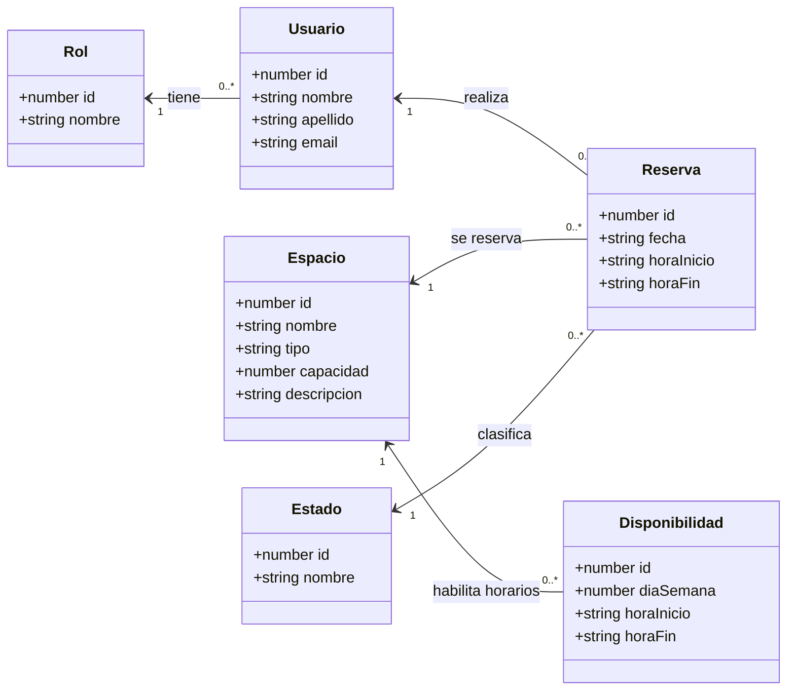

# Modelo de dominio — Reserva de espacios

## Propósito

Representar los conceptos que utiliza el sistema y sus relaciones. El modelo refleja las seis entidades actuales; las reglas de horarios y transiciones se detallan en [reglas de negocio](reglas-negocio.md).

## Conceptos

| Concepto | Significado |
|---|---|
| Usuario | Persona registrada que puede asociarse a reservas. Su email es único. |
| Rol | Clasificación del usuario. Los valores iniciales son administrador y usuario. No otorga permisos efectivos en esta etapa. |
| Espacio | Aula, laboratorio u otro lugar reservable. Tiene tipo, capacidad y descripción opcional. |
| Disponibilidad | Franja semanal en la que se habilita un espacio. No representa una reserva ni una fecha puntual. |
| Reserva | Solicitud de uso de un espacio por un usuario, en una fecha concreta y un intervalo horario. |
| Estado | Situación de una reserva: pendiente, aprobada, rechazada o cancelada. |

## Cómo leer las relaciones

- Cada usuario tiene exactamente un rol; un rol puede corresponder a cero o muchos usuarios.
- Cada reserva pertenece a un usuario y a un espacio; ambos pueden participar en muchas reservas.
- Cada reserva tiene exactamente un estado; un estado puede clasificar muchas reservas.
- Cada disponibilidad corresponde a un espacio; un espacio puede tener varias franjas o ninguna.

No existe una relación persistida directa Reserva–Disponibilidad. La reserva se valida buscando una franja del mismo espacio que cubra su día y horario.

## Horarios y fechas

- `diaSemana` usa 0 para domingo y 6 para sábado.
- `fecha` se comunica como texto `AAAA-MM-DD` y se persiste como DATE.
- Las horas se comunican como `HH:mm:ss` y se persisten como TIME.
- La descripción de Espacio puede estar vacía o ser nula en la base.

## Identificadores

Las entidades heredan su identificador numérico de BaseEntity. Esta clase es un recurso técnico del código y no se muestra como una entidad adicional del negocio.

## Ejemplo

Un espacio tiene disponibilidad los lunes de 09:00 a 12:00. Una reserva para el lunes 19/10/2026, de 10:00 a 11:00, se puede registrar si ninguna reserva pendiente o aprobada ocupa parte de ese horario.

Una reserva de 11:00 a 12:00 puede comenzar justo cuando termina la anterior.

## Aprobación posterior

La entidad Rol ya existe. Para que los roles controlen el acceso todavía deben implementarse el login y las comprobaciones de permisos en backend y frontend.
