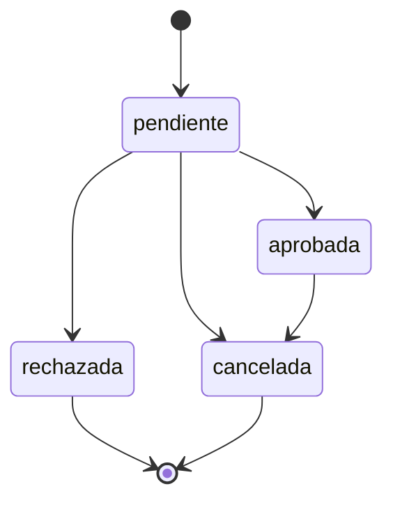

# Reglas de negocio y casos de uso

## 1. Conceptos de horario

**Disponibilidad:** horario semanal habilitado para un espacio. Ejemplo: todos los lunes de 09:00 a 12:00.

**Reserva:** solicitud para una fecha concreta. Ejemplo: lunes 19/10/2026, de 10:00 a 11:00.

Cada reserva ocupa el espacio completo durante su intervalo. La capacidad se informa como característica del lugar; no se registran cupos ni una cantidad de asistentes por reserva.

El sistema trabaja con una fecha y un intervalo dentro del mismo día. No admite una hora final menor o igual a la inicial para una reserva que ocupa horario.

## 2. Cuándo un espacio está disponible

Para el intervalo solicitado deben cumplirse ambas condiciones:

1. Una franja semanal del espacio cubre el intervalo completo.
2. No existe una reserva pendiente o aprobada que se superponga en esa fecha.

Sin una franja configurada que cubra el intervalo, el espacio se considera no disponible.

Actualmente una sola franja debe cubrir todo el intervalo. Dos franjas consecutivas, por ejemplo 09:00–12:00 y 12:00–15:00, no se combinan automáticamente para una solicitud de 11:00–13:00.

## 3. Superposición

Una reserva existente se cruza con la solicitada cuando:

```text
inicioExistente < finSolicitado
y
finExistente > inicioSolicitado
```

También deben coincidir espacio y fecha, y el estado existente debe ocupar horario.

| Reserva existente | Solicitud | Resultado |
|---|---|---|
| 09:00–10:00 | 09:30–10:30 | Se superponen |
| 09:00–10:00 | 10:00–11:00 | Son contiguas: permitido |
| 09:00–12:00 | 10:00–11:00 | Se superponen |
| 09:00–10:00 | Otro espacio, 09:00–10:00 | No hay conflicto entre esos espacios |

La consulta del listado es informativa. Al crear o modificar una reserva que ocupa horario, el backend vuelve a comprobar la condición.

## 4. Estados

Toda reserva se crea como **pendiente**.

| Estado actual | Siguientes estados permitidos | Ocupa horario |
|---|---|---|
| pendiente | aprobada, rechazada, cancelada | Sí |
| aprobada | cancelada | Sí |
| rechazada | Ninguno | No |
| cancelada | Ninguno | No |



Las reservas rechazadas y canceladas no se modifican mediante el endpoint de actualización actual. Para realizar otra solicitud se crea una nueva reserva.

La eliminación física es una operación distinta, disponible en la API. La interfaz utiliza la cancelación para conservar el registro.

## 5. Formatos y datos

- IDs enviados en cuerpos JSON: números enteros positivos.
- Fecha: texto `AAAA-MM-DD`, con una fecha existente.
- Horas: texto `HH:mm:ss`.
- Día semanal: entero de 0 a 6; 0 es domingo.
- Espacio: nombre y tipo no vacíos; capacidad numérica, entera y positiva.
- Usuario: nombre y apellido no vacíos; email normalizado y único.

La API de actualización de reserva comprueba fecha y formato de hora de los datos enviados. El control de franja, orden del intervalo y superposición se aplica cuando la reserva resultante ocupa horario.

## 6. Filtros

### Espacios

- Todos: devuelve el conjunto de espacios.
- Disponibles: aplica la regla de franja cubierta y ausencia de reserva bloqueante.
- No disponibles: devuelve el complemento, incluyendo espacios sin horario configurado para ese intervalo.

El filtro de disponibilidad requiere fecha, hora inicial y hora final.

### Reservas

Se filtra por nombre de estado, por fecha exacta o por ambos atributos. No es un filtro por rango de fechas.

## 7. CUU — Realizar una reserva

**Actor en regularidad:** operador que utiliza la aplicación; todavía no hay sesión autenticada.

**Precondiciones:** usuario y espacio existentes, y horario semanal configurado.

**Flujo principal:**

1. El operador consulta los espacios para la fecha y el horario deseados.
2. Selecciona usuario y espacio e ingresa fecha y horas.
3. El frontend envía los datos a la API.
4. El backend comprueba datos, relaciones, franja y superposición.
5. Se guarda la reserva con estado pendiente.
6. La interfaz informa el resultado y actualiza el listado.

**Alternativas:**

- Datos incorrectos o franja no cubierta: 400.
- Usuario o espacio inexistente: 404.
- Reserva que ocupa el horario: 409.
- Fallo inesperado: respuesta 500 con mensaje controlado.

**Resultado:** existe una reserva pendiente que ocupa ese espacio e intervalo.

## 8. CUU — Aprobar o rechazar

**Actor en regularidad:** operador de la aplicación. La restricción a un administrador autenticado corresponde a aprobación.

1. Buscar reservas pendientes.
2. Abrir el detalle, que consulta la reserva con usuario, espacio y estado.
3. Seleccionar Aprobar o Rechazar.
4. Obtener el ID del estado correspondiente a partir del catálogo consultado.
5. Enviar el cambio a la API.
6. Validar la transición y guardar el estado.
7. Refrescar el detalle y el listado.

Una aprobación mantiene ocupado el horario. Un rechazo lo libera.

## 9. Cancelación

Puede cancelarse una reserva pendiente o aprobada. La acción conserva el registro y libera su horario. La interfaz pide confirmación.

## 10. Límites del comportamiento actual

- No se aplica una regla general que prohíba fechas pasadas.
- Las modificaciones o eliminaciones de franjas no cancelan automáticamente las reservas existentes.
- No existe una validación que prohíba franjas semanales duplicadas o superpuestas.
- La consulta previa de conflictos no equivale a un mecanismo de exclusión para dos escrituras simultáneas.
- Los roles son datos precargados; no restringen acciones hasta implementar autenticación y autorización.
- Hay eliminación física de reservas en la API; el frontend expone cancelación y cambios de estado, no un formulario general de edición de fecha y horario.

Estas precisiones describen el código de esta entrega y sirven para acordar el alcance posterior.
